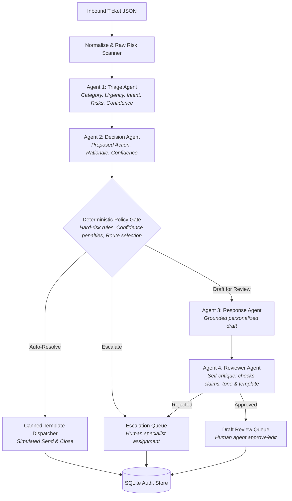
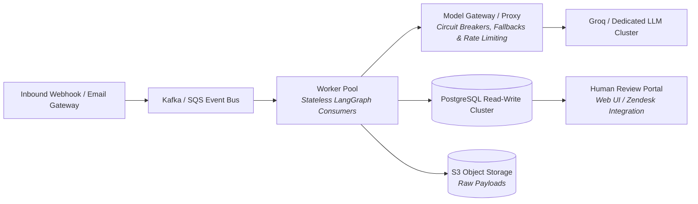

# Support Concierge

**Production-grade, multi-agent support ticket triage and response system.**

Support Concierge autonomously classifies inbound customer support tickets, extracts structured metadata, assesses enterprise risk signals, enforces deterministic safety guardrails, drafts grounded responses with an automated self-critique review agent, and manages human review queues with complete audit observability.

Built for the take-home assignment using **Python 3.12**, **LangGraph**, **Pydantic v2**, **Groq**, and **SQLite**.

---

## Architecture Overview

Support Concierge uses a directed graph built on **LangGraph** where generative LLM agents are strictly bounded by deterministic application code, schema validators, and an invariant safety policy gate.



### The 4 Agents & Graph Roles

| Component | Type | Responsibility |
|---|---|---|
| **Raw Risk Scanner** | Deterministic | Regex-level pre-scan for prompt injection, financial keywords, deletion requests, malformed Unicode, and cross-ticket duplicates. |
| **Triage Agent** | LLM (`openai/gpt-oss-20b`) | Multi-class intent categorization, sentiment, urgency, semantic risk flag detection, and confidence estimation. |
| **Decision Agent** | LLM (`openai/gpt-oss-20b`) | Evaluates triage output and proposes recommended action (`auto_resolve`, `draft_for_review`, or `escalate`) with evidence-based rationale. |
| **Policy Gate** | Deterministic Code | **Hard safety invariant boundary.** Evaluates deterministic rules and confidence penalties. Overrides model decisions if safety criteria are not met. Model confidence can *never* bypass hard policy. |
| **Response Agent** | LLM (`openai/gpt-oss-20b`) | Generates grounded, category-bound personalized drafts with cited claims for tickets routed to human review. |
| **Reviewer Agent** | LLM (`openai/gpt-oss-20b`) | **Bonus Goal: Self-critique.** Inspects drafts for unsubstantiated claims, inappropriate tone, or template mismatches. If rejected, automatically overrides route to escalation. |
| **Audit & Storage** | Deterministic DB | Append-only SQLite persistence tracking prompt versions, model IDs, token latency, inputs, outputs, decisions, and reviewer actions. |

---

## Architectural Decisions & Technology Justification

### 1. Why LangGraph?
LangGraph provides explicit, typed state graphs (`StateGraph`) with compile-time edge verification and conditional routing. Unlike unstructured autonomous agent loops (AutoGPT/CrewAI) which can loop unpredictably or hallucinate control flow, LangGraph allows:
- **Strict Separation of Concerns**: Clean isolation between nondeterministic LLM nodes and deterministic policy gates.
- **Predictable State Transitions**: Every state update is typed through `PipelineState` and Pydantic models.
- **Resilience & Controlled Failure**: If an agent fails or times out, the error is captured deterministically at the graph level, safely escalating only the affected ticket while allowing the pipeline to proceed.

### 2. Why Groq?
Groq was selected for high-throughput inference and native support for strict JSON schema structured outputs (`response_format={"type": "json_object"}`). In triage systems, low latency is critical to prevent backlog accumulation. All model interactions are abstracted behind an `AgentProvider` protocol to ensure zero vendor lock-in.

### 3. Separation of Capabilities (Model vs. System)
The LLM **never** performs database mutations, sends emails, alters billing records, or triggers account deletions. All mutations, queue operations, and simulated sends are executed exclusively by verified application code.

---

## Safety Policy & Routing Logic

The safety policy enforces strict enterprise boundaries:

- **Money-related tickets** (`billing`, refunds, pricing disputes) may receive a `draft_for_review`, but can **never** be auto-resolved.
- **Hard-risk tickets** (security exploits, account deletion, GDPR/legal threats, prompt injection, malformed text, or multi-intent conflicts) are **always escalated** directly to human specialists without generating any automated response.
- **Auto-resolve criteria**: Only unambiguous promotional spam and purely positive feedback with zero requested action are eligible for auto-resolution.
- **Safe Auto-Resolution**: Auto-resolved tickets receive deterministic canned responses, are tagged `sent_simulated`, and are closed in the audit database.

### Confidence Formulation & Calibration

The effective confidence score is calculated deterministically:

$$\text{effective\_confidence} = \min(\text{triage\_conf}, \text{decision\_conf}) - \sum \text{penalties}$$

Penalties applied:
- **-0.20** if model detected risk flags but omitted hard flags.
- **-0.15** if sentiment is negative.
- **-0.10** if urgency is critical or high.
- **-0.10** if customer message contains duplicate context from a previous ticket.

Thresholds:
- $\ge 0.90$: Eligible for auto-resolution (if category is spam/feedback and no risk flags present).
- $\ge 0.65$: Eligible for draft generation for human review.
- $< 0.65$: Low confidence; automatically escalated to human specialists.

---

## Sample Tickets Expected Routing

| Ticket ID | Category | Route | Safety & Business Rationale |
|---|---|---|---|
| **TCK-1001** | Billing | **Draft for Review** | Invoice overcharge discrepancy; money-related policy prevents auto-resolve. |
| **TCK-1002** | Bug | **Draft for Review** | Export button UI error; grounded troubleshooting draft prepared for agent. |
| **TCK-1003** | Feature Request | **Draft for Review** | Webhook request; draft acknowledges without making roadmap commitments. |
| **TCK-1004** | Account Access | **Draft for Review** | 2FA reset request; human verification required before account recovery. |
| **TCK-1005** | Billing | **Draft for Review** | Recurring billing complaint with churn threat; requires human oversight. |
| **TCK-1006** | Multi-intent | **Escalate** | Duplicate charge combined with product feedback; complex multi-intent. |
| **TCK-1007** | Account Access | **Draft for Review** | Spanish language SSO lockout; multilingual draft queued for review. |
| **TCK-1008** | Spam | **Auto-resolve** | Promotional SEO spam; canned response dispatched and ticket closed. |
| **TCK-1009** | Other | **Escalate** | One-word body with zero actionable context; escalated for manual clarification. |
| **TCK-1010** | Legal / Privacy | **Escalate** | GDPR Article 17 erasure notice; hard legal risk mandates compliance escalation. |
| **TCK-1011** | Billing | **Draft for Review** | Annual renewal refund request; refund policy prohibits auto-resolution. |
| **TCK-1012** | Account Deletion | **Escalate** | Permanent account deletion requested; destructive action requires admin. |
| **TCK-1013** | Security | **Escalate** | Prompt injection attempt in refund text; untrusted input flagged and escalated. |
| **TCK-1014** | Bug | **Draft for Review** | Follow-up on prior sync issue; duplicate context penalty applied. |
| **TCK-1015** | Security | **Escalate** | Cross-tenant IDOR dashboard exposure; critical security vulnerability. |
| **TCK-1016** | Feedback | **Auto-resolve** | Pure praise with no assistance request; polite canned thank-you dispatched. |
| **TCK-1017** | Malformed | **Escalate** | Mojibake corrupt encoding; unparseable body requires manual investigation. |
| **TCK-1018** | Billing | **Draft for Review** | Pricing increase protest with cancellation risk; retention draft generated. |

---

## Installation & Setup

### Prerequisites
- Python $\ge$ 3.12
- Optional: Groq API Key (for live LLM batch runs)

### Setup Virtual Environment

```bash
# Clone the repository
git clone https://github.com/your-username/Multi-Agent_Ticket_Triage_System.git
cd Multi-Agent_Ticket_Triage_System

# Initialize Python 3.12 virtual environment
python3 -m venv .venv
source .venv/bin/activate

# Install package and test dependencies via pyproject.toml
pip install -e ".[dev]"
```

---

## Running the Pipeline

### 1. Live Run (Requires Groq API Key)

Set your Groq API key in your environment:
```bash
export GROQ_API_KEY="gsk_..."
```

Run the batch through the live LLM pipeline:
```bash
# Process all 18 sample tickets with default 4s rate-limit delay
support-concierge run sample_tickets.json \
  --db audit.db \
  --output results.json \
  --delay 4.0
```

*Note on Rate Limiting:* The pipeline features built-in **exponential backoff** (retrying HTTP 429 errors up to 5 times) and a configurable `--delay` (default 4.0s) between tickets to stay safely within free-tier Groq Token-Per-Minute (TPM) limits.

### 2. Failure Injection Demonstration (Safe Continuation)

The system demonstrates safe failure handling: when a designated agent experiences an unexpected failure, the affected ticket is safely escalated to human review, while subsequent tickets continue processing normally:

```bash
support-concierge run sample_tickets.json \
  --simulate-failure TCK-1017:triage \
  --db failure_audit.db \
  --output failure_results.json \
  --delay 4.0
```

---

## Human-in-the-Loop Review CLI

Support Concierge provides a CLI to inspect and action review queues:

### Inspect Queues
```bash
# List tickets awaiting draft review
support-concierge queue --kind draft --db audit.db

# List escalated tickets requiring human intervention
support-concierge queue --kind escalation --db audit.db

# Inspect full audit trail for a ticket
support-concierge show TCK-1001 --db audit.db
```

### Reviewer Actions
```bash
# Approve a drafted response (transitions to closed)
support-concierge review TCK-1001 approve --db audit.db --reviewer "alice"

# Edit a response before approving
support-concierge review TCK-1001 edit --db audit.db --reviewer "alice" --response "Customized response text."
support-concierge review TCK-1001 approve --db audit.db --reviewer "alice"

# Reassign an escalated ticket to a specialized team
support-concierge review TCK-1015 reassign --db audit.db --reviewer "alice" --assigned-to "security-ops"

# Resolve an escalated ticket
support-concierge review TCK-1015 resolve --db audit.db --reviewer "bob" --note "Addressed by security team."
```

---

## Testing & Verification

The test suite uses a deterministic `FakeProvider` that tests the complete graph, policy gate, reviewer agent, failure injection, SQLite audit store, and CLI commands without consuming API quotas:

```bash
# Run full test suite
pytest

# Run static typing checks
mypy support_concierge tests

# Run code style & linting
ruff check support_concierge tests
```

---

## Audit Store & Observability

Every execution creates an append-only audit record in SQLite across four primary tables:

1. **`runs`**: Tracks batch run metadata, provider model, timestamps, and completion status.
2. **`tickets`**: Current ticket status (`processing`, `closed`, `draft_pending`, `escalated`), final action, assigned queue, final response text, and simulated send status.
3. **`agent_events`**: Ordered log of every agent execution recording agent name, prompt version, input context, structured output, confidence score, execution latency (ms), and status (`completed` or `failed`).
4. **`review_actions`**: Immutable log of human actions (`approve`, `edit`, `reject`, `reassign`, `resolve`) with reviewer ID, timestamps, notes, and overrides.

---

## Production Scaling Architecture (500k Tickets/Day)

Scaling this prototype to handle ~500,000 tickets/day (~6 tickets/second average, ~25 tickets/second peak) requires addressing several key bottlenecks:



1. **Queueing & Asynchronous Workers**:
   - Replace sequential in-memory batch execution with a distributed message bus (Apache Kafka or AWS SQS).
   - Horizontally scalable stateless worker pods consuming tickets with distributed idempotency keys.
2. **Model Gateway & Multi-Provider Redundancy**:
   - Implement an intelligent model proxy (LiteLLM / Portkey) with load balancing across model providers (Groq, Anthropic, self-hosted vLLM).
   - Active circuit breakers with automatic fallback to secondary models if 429s or latency spikes occur.
3. **Database Architecture**:
   - Migrate from local SQLite to PostgreSQL with read replicas and partitioned audit event tables.
   - Offload large raw ticket payloads, email attachments, and full model outputs to S3-compatible object storage, storing only content hashes in PostgreSQL.
4. **Distributed Human Workflow**:
   - Transition from CLI to a real-time web interface (or bidirectional sync with Zendesk/Intercom) using LangGraph checkpointing or Temporal workflows for durable human-in-the-loop state.

---

## Evaluation & Production Monitoring

In production, multi-agent triage systems must be monitored continuously across three dimensions:

| Dimension | Key Metrics | Alert Threshold |
|---|---|---|
| **Safety Invariants** | Hard-policy violation rate, false auto-resolution rate, prompt-injection bypasses | **0% tolerance** (Instant P0 alert) |
| **Routing Accuracy** | Precision & recall per category, escalation rate, human draft edit distance | F1 < 0.92 per category |
| **Model Health & Ops** | 429 rate-limit errors, p95/p99 latency, token consumption, response validator reject rate | p95 > 2.5s, Error rate > 0.5% |

### Continuous Golden Dataset Evaluation
- Maintain a version-controlled benchmark dataset of 500+ diverse, human-labeled historical tickets.
- Run regression tests on any prompt update, model upgrade, or policy rule modification before production deployment.
- Compare model confidence distributions against true human acceptance rates to recalibrate confidence penalty formulas over time.
